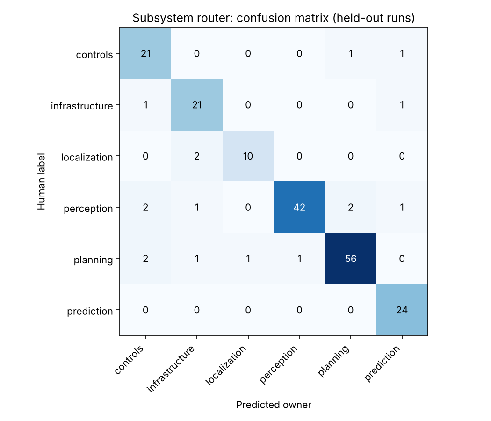

# Router evaluation

Train failures: 575 · Test failures: 191 (split by run)

| Method | Accuracy | Macro F1 |
|---|---|---|
| majority_class | 0.319 | 0.081 |
| log_module_rule | 0.764 | 0.740 |
| tfidf_logreg | 0.911 | 0.900 |

**Routing policy** (confidence ≥ 0.6): 86% of failures auto-routed at 97.6% accuracy; 27 sent to human review.

## Per-class report

```
                precision    recall  f1-score   support

      controls      0.808     0.913     0.857        23
infrastructure      0.840     0.913     0.875        23
  localization      0.909     0.833     0.870        12
    perception      0.977     0.875     0.923        48
      planning      0.949     0.918     0.933        61
    prediction      0.889     1.000     0.941        24

      accuracy                          0.911       191
     macro avg      0.895     0.909     0.900       191
  weighted avg      0.916     0.911     0.912       191

```

